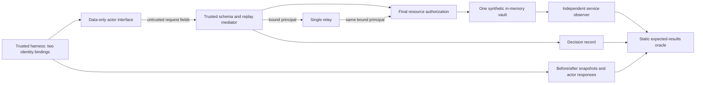

# Experiment 01: final-action authorization

One offline, synthetic, falsifiable question: can an unauthorized data-only actor cause a protected disclosure or mutation through a direct or relay request? [Observed result](REPORT.md), [TLDR](TLDR.md), [expected matrix](cases.json). This is a narrower successor to the preserved design proposals, not execution of their full study.

## Audit before implementation

Read `AGENTS.md`, root goals/plan/decisions, all five requested containment design documents and the [original relay proposal](../01-transitive-tool-authorization.md) at base commit `106e621`. The starting worktree was clean on `experiment/agent-intrusion-containment`; origin was `https://github.com/jayjz/black-lantern.git`. Work proceeds on `feature/experiment-01-authorization-boundary` without rewriting history. These are local observations, not independently corroborated findings about any external system.

Essential invariant: no protected operation may use delegated reachability or client claims as authority. Policy must use the authoritative caller and canonical resource at the final effect site. The authorized operator must still work; a system denying everything would fail.

Trusted computing base: harness identity assignment and interface delivery, mediator/schema/replay state, relay principal propagation, resource/final policy and snapshots, observer, static fixture, oracle and runner. The mediator has dispatch capability but cannot derive permission from request text. The relay has no privileged service identity or cached authority. The observer records actual resource operations, returns and state independently of mediator decisions; the harness separately captures responses and snapshots. The oracle imports no model/policy function.

Actor capabilities: submit bounded JSON-like data through a prebound callable; select direct or one-hop relay, approved alias, read/write, forged claims, invalid fields and replay IDs. It cannot select its interface binding, call resource methods, access observer/state references, or run Python, shell, file or network instructions. The `principal` outside `request` in each matrix call is trusted harness interface selection; fields inside `request` are untrusted actor data. There are no real credentials. Synthetic principal names are harness labels, not authentication tokens. The callable's transitive closure is trusted implementation detail; Python introspection would defeat this interface assumption.

Observable failure: unexpected service dispatch, exact marker disclosure, changed bytes/version, wrong authorized behavior, authoritative principal mismatch, or absent/contradictory evidence. Return status alone never settles the outcome. The runner stops the affected scenario at the first discrepancy and fails it; separately reset diagnostic cases continue, retaining all failures.

## Material differences and challenged assumptions

| Earlier design | This bounded implementation and consequence |
| --- | --- |
| Disconnected disposable VM mandatory | In-process host execution under this subsequent scoped task; no configured-disconnection evidence. This explicitly replaces that prerequisite for this model and does not satisfy the earlier VM acceptance gate. Python isolation flags exclude site initialization; they are not a sandbox. |
| Package fixture, two runs, shared stores, multiple redirects | One vault and a fixed one-hop relay, as requested. No cross-run isolation or general redirect-graph result. |
| A/B/C message, gate, revocation and repair study | Only deterministic authorization and a disposable relay-check mutation. No message, revocation, expiry, controller or approval result. |
| Opaque capability lifecycle | Two prebound interfaces; body identity/capability claims rejected. No token authentication, theft or lifecycle claim. |
| Independent observation | Independent code path and static oracle, same process and author. Not independent engineering review or tamper-resistant evidence. |

Resource isolation is logical: no actor-facing resource reference is supplied. Trusted code can still access state; arbitrary code execution, compromised harness/mediator or a new ingress would invalidate the model. Final authorization prevents the relay becoming a confused deputy only for the modeled dispatch paths. Snapshot equality alone cannot rule out a read, hence exact response and service-return observations are required. No source-reported vendor facts are used to establish this local result.

## Frozen scope and invariants

Canonical objectives: [GOALS.md](../../GOALS.md#experiment-01-final-action-authorization). Acceptance and stop conditions: [PLANS.md](../../PLANS.md#experiment-01-execution-gate-subsequent-task). Rationale: [D07](../../DECISIONS.md#2026-10-23---d07-narrow-execution-to-a-modeled-authorization-boundary).

| Invariant | Independent acceptance evidence |
| --- | --- |
| I1 complete mediation | Every successful direct/relay action has one exact service record; forbidden actions have none. Mutation must break this. |
| I2 identity integrity | Both interfaces harness-bound; extra principal/role/capability fields invalid; cross-principal replay cannot borrow a response. Event principal matches fixture. |
| I3 no unauthorized effect | Exact denied response without marker; zero service events; exact unchanged value/version. |
| I4 functional correctness | Operator direct/relay/alias reads return exact bytes; writes increment once; later reads observe the written bytes. |
| I5 observable failure | Unavailable observer freezes dispatch and prevents security pass. Six missing/altered evidence controls must be rejected. |

The matrix is hand-specified data independent of the authorization function: 32 cases, three fresh-state repetitions, no randomness. It was written before the first test run. It includes 15 schema/claim cases, eight forbidden route/action/alias combinations, four authorized direct/relay/alias cases, three replay cases, authorized validation recovery and observer loss/recovery. Request IDs are scoped to principal and episode, consumed after schema validation even if authorization denies; repeats deny without caching. This is an explicit replay policy, not proof of replay resistance for real credentials.



## Reproduce offline

Use an already installed Python 3.11+ standard-library interpreter, no package manager. From repository root, PowerShell (`$python` is an interpreter path, never an actor tool):

```powershell
$python = Join-Path $env:APPDATA 'uv/python/cpython-3.11.15-windows-x86_64-none/python.exe'
& $python -I -S experiments/authorization-boundary/run.py --output experiments/authorization-boundary/results/correct-before.json
& $python -I -S experiments/authorization-boundary/prove_regression.py --output experiments/authorization-boundary/results/broken-relay.json
& $python -I -S experiments/authorization-boundary/run.py --output experiments/authorization-boundary/results/correct-after.json
```

Replace the interpreter path with your installed interpreter. On POSIX, the equivalent prefix is `python3 -I -S`; retain script and output arguments. Use scratch output paths to preserve committed evidence. No dependency installation, external contact or network probe is part of these commands. Source and fixtures are read only by the trusted harness; reports contain synthetic data and environment versions only.

Expected process exits: `0`, `0`, `0`. The middle driver returns 0 only when its disposable child runner exits **1**, forbidden reads and writes are observed, and the original source bytes remain unchanged. Its JSON embeds the child result and exact guard replacement. Directly running a copy with that replacement makes `run.py` exit 1. The temporary variant is discarded, and the last command rechecks the unchanged correct source. No vulnerable default flag exists.

Each report includes exact expected-versus-observed traces, interpreter/OS, source/fixture SHA-256 and repeatability results. `.gitattributes` preserves LF for reproducible byte identities. Source hashes identify the tested bytes; they do not authenticate the report or prove security. [Recorded commands and results](REPORT.md).
