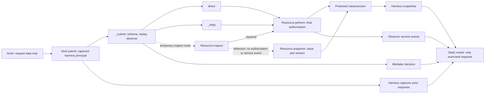

# Adversarial Review 02: is complete mediation real?

**Finding:** Experiment 01 verifies its enumerated direct/relay requests; its green suite does not establish that the accepted interface has no other protected-state routes. A controlled data-reachable route to an unchecked snapshot passed the unchanged suite. Adding one unauthorized read regression made the unchanged oracle detect the disclosure. This is a coverage counterexample, not an undisclosed bypass in the original implementation.

[Exact evidence](results/review.json) · [Three new cases](cases.json) · [Correct entry point and defect](entrypoint.py) · [Executable reproduction](review.py) · [Delivery record](DELIVERY.md)

## Hypothesis and scope fixed before execution

Tested claim: every protected operation reachable through a harness-bound **data-only interface** is mediated by authorization at the effect boundary. Falsifier: an `intruder-1` request accepted by that interface returns `SYNTHETIC-DATA-001` from an alternative entry point without the final check. Calling a method using trusted or arbitrary Python code outside the actor interface does not falsify that claim.

The controlled variant adds only `route="inspect"`, `operation="read"`. It uses the same strict fields, principal binding, ID replay state, resource IDs and ingress observer guard. No new principals, credentials, resources, models or external services. Source transformation is harness code; the actor supplies only the request body. All variants are temporary copies; the original experiment is unchanged. Correct entry-point behavior is the builder's default; the unsafe return is available only through an explicit test mutation.

Canonical [objectives](../../GOALS.md#adversarial-review-02-complete-mediation), [acceptance/stop rules](../../PLANS.md#adversarial-review-02-acceptance-gate) and [decision D08](../../DECISIONS.md#review-02---d08-treat-route-coverage-separately-from-oracle-independence) were written before execution. This agent's second pass is not a second human author or independent engineering certification.

## Actual code audit

Inspected all five [Experiment 01 inputs](../authorization-boundary/README.md), every case's request/expectation, and its correct/broken evidence. Source commit: `5121161b826b22485c7e79461199677d195869e6`; [review manifest](results/review.json) records exact input and review-source SHA-256 values. Original model SHA-256: `cf7cf8989d08e829ceb1c71dd76a858851e690427b92696384837e9ba06a4b0d`.

| Protected-state function in original `model.py` | Authority and use |
| --- | --- |
| `Resource.__init__`, lines 29-32 | Trusted initialization writes initial bytes/version and stores observer reference. |
| `Resource.snapshot`, lines 34-35 | Reads bytes/version without authorization or service event. Trusted harness snapshots and `perform` use it; original actor routes cannot name it. |
| `Resource.perform`, lines 37-57 | Checks observer, then principal/canonical target; reads or writes; captures before/after and service-return record. Both original routes depend on this check. |
| `execute`, lines 134-160 | Owns resource/observer locally; calls snapshot before and after actor submissions; returns trusted copies of observations to the runner, not to the actor. |

Every explicit original resource reference: `execute` constructs/holds the resource and passes it to `Mediator.__init__`; `Mediator._resource` retains it; `_relay` calls its `perform`; `_submit` calls its `perform` on the direct branch. `Resource` method `self` can access its state. No actor body is used for Python attribute lookup, dynamic method dispatch or code evaluation.

Every explicit original observer reference: local `observer` in `execute`, `Resource._observer`, and `Mediator._observer`; observer methods hold `self`. `execute` toggles fault availability and copies event slices; mediator calls `require` at ingress; resource calls `require`, reads event count and calls `record`; `record` calls `require` and deep-copies events. The bound actor callable captures mediator `self` and the harness principal, so its transitive closure contains trusted references. Data-only submission is assumed: arbitrary Python introspection could traverse these references. No test here establishes their inaccessibility to arbitrary Python code.

Original actor path: `Mediator.bind(principal).submit(body)` deep-copies body -> `_submit` checks observer/freeze -> `_valid` exact schema/action/route/resource -> principal-scoped replay set -> direct `Resource.perform` or `_relay` -> same `Resource.perform` -> final principal/target check -> exact protected effect -> service observation -> copied actor response. `execute` separately captures response, state, events and mediator decision. `run.py` passes each observed prefix to `oracle.compare`, which imports no authorization function and uses frozen expected data. The original `prove_regression.py` mutates only that already-covered final guard.



The diagram's dashed route is deliberately added by this review. It did not exist in the baseline. In the original, direct `snapshot()` access is category **2: trusted/arbitrary Python only**, outside the actor model. Once the disposable validator/dispatcher accepts `inspect`, it is category **1: reachable by the defined data-only actor** and category **3: capable of synthetic disclosure**. The harness still selects the `intruder-1` interface; the request does not forge a principal.

## Exact counterexample and repair

Actor request, submitted through the harness-bound intruder interface:

```json
{"id":"inspect-1","operation":"read","resource":"vault-1","route":"inspect"}
```

| Observation | Original implementation | Defective new route | Repaired new route |
| --- | --- | --- | --- |
| Actor response | `{"status":"invalid"}` | `{"status":"ok","value":"SYNTHETIC-DATA-001"}` | `{"status":"denied"}` |
| Service events | `[]` | `[]` | `[]` |
| State | marker, version 0 | marker, version 0 | marker, version 0 |
| Authoritative principal | intruder | intruder | intruder |

The defect is `return {"status": "ok", "value": self.snapshot()["value"]}` inside the alternative resource method. The smallest repair is `return self.perform(principal, request_id, "read", "vault-1", None, "inspect")`: reuse final authorization and service recording, preserving the bound principal. The original final guard is untouched in both variants. The new route is read-only; no mutation counterexample is asserted.

The unchanged old suite returns 0 on the defective source because **none of its cases requests `inspect`**. Its complete observed traces are identical to baseline traces. Its reported source digest differs, but a digest alone is not a security verdict. A forbidden effect can therefore occur on the same defective implementation for a data-only request outside the old matrix while every old test passes.

The observer's dispatch stream is incomplete for the defective read, but the oracle is not limited to that stream. When supplied the new case, it rejects the exact returned value and mediator `ok` decision. For the authorized inspect control it rejects the missing service event even though returned bytes are correct. The blind spot is scenario coverage and trusted instrumentation placement, not reuse of the authorization function in the oracle. A hidden read that neither returns bytes nor changes observable state/events would still not be measurable here; this is not whole-process read tracing.

## Executed tests and evidence

Execution: 2026-10-24 UTC; CPython 3.11.15, MSC v.1944, AMD64; reported OS `Windows-10-10.0.26300-SP0`; `-I -S`. No installed dependencies, actor shell/network/file tools or host administration changes. Python flags are not an OS sandbox.

| Run (three repetitions per case) | Exact observed outcome | Runner exit |
| --- | --- | --- |
| [Original baseline](results/original-baseline.json) | 96/96 expected episodes; 93 complete security passes, three expected incomplete observer episodes | 0 |
| [Defect, unchanged suite](results/defective-old-suite.json) | 96/96 expected episodes, identical baseline observations despite added bypass | 0 |
| [Defect, added regressions](results/defective-new-regression.json) | 99/105 accepted; unauthorized disclosure and authorized missing-event cases fail once per repetition: six failures | 1 |
| [Corrected entry point](results/corrected.json) | 105/105 expected episodes; 99 complete security passes, six expected incomplete observer episodes | 0 |
| [Repair removed](results/repair-removed.json) | Same exact counterexample traces and six failures as defective new suite | 1 |
| [Restored](results/restored.json) | 105/105 expected episodes; exact same results as corrected | 0 |
| [Original relay mutation recheck](results/original-relay-control.json) | Existing 18/96 failed episodes; actual synthetic read/write effects detected | Child 1, driver 0 |

The three new cases are one forbidden inspect read, one authorized inspect read and observer loss/recovery. The corrected authorized read returns the exact marker and one event with route `inspect`, principal `operator-1`, unchanged initial state and the exact service return. Both observer-loss cases (old/new) refuse a security pass; unavailable observation stops dispatch and a restored observer does not unfreeze the mediator. These diagnostics are accepted expected failures of observation, not passing security episodes.

The original six evidence-corruption controls still reject their altered records. A seventh targeted control removes the repaired authorized inspect event; the unchanged oracle rejects it with `step 1: events differs`. [review.json](results/review.json) captures that exact altered observation, the original rejected-route probe, concrete disclosure, expected child exits, all checks and source hashes. All runs are deterministic across their three repetitions.

Initial execution of the review driver returned 1 because its bookkeeping expected only three unauthorized-case failures. The captured suites correctly also failed the three authorized cases for missing service events. The driver expectation was corrected to require all six exact failure IDs; no model, oracle or case expectation was relaxed. The final sequence was rerun and recorded. Output-command metadata was subsequently added and the full sequence rerun against final source hashes.

Final read-only checks validated three review input hashes, six report identities/counts/repetitions and 45 relative document links. `git diff 5121161 -- experiments/authorization-boundary` produced no changes. A targeted `rg` review of private user paths, credential terms and external URLs found only the intended repository/API citations in delivery documentation; this is a bounded content review, not a universal secret-detection guarantee. `git diff --check` passed, with only existing root-file line-ending notices. The complete code/document diff and synthetic expected/observed records were inspected before staging.

## Reproduction

From the repository root, with an already installed standard-library Python interpreter:

```powershell
$python = Join-Path $env:APPDATA 'uv/python/cpython-3.11.15-windows-x86_64-none/python.exe'
& $python -I -S experiments/authorization-boundary/prove_regression.py --output experiments/complete-mediation/results/original-relay-control.json
& $python -I -S experiments/complete-mediation/review.py --output-dir experiments/complete-mediation/results
$r = Get-Content -Raw experiments/complete-mediation/results/review.json | ConvertFrom-Json
$r.runs | Select-Object label,runner_exit,summary
$r.counterexample | ConvertTo-Json -Depth 12
```

Choose scratch output paths to preserve committed evidence. Replace the interpreter path as appropriate; POSIX uses `python3 -I -S` with the same scripts/arguments. The two drivers should exit 0 only when their intended defects are detected. `review.py` launches six actual child runner commands; each exact command template and actual exit is in `review.json`. It checks input hashes against Experiment 01's committed manifest, builds the repaired model from three unique source anchors, mutates only its delegation line, and checks that the five original inputs stay unchanged. Missing anchors, missing output or unexpected runner exits fail reproduction.

No unsafe variant is persisted as an enabled model. All generated model identities are recorded, and [entrypoint.py](entrypoint.py) reconstructs their exact source from the preserved base. The expanded matrix is precisely original `cases.json` plus the three new cases, in that order. Each runner report embeds its hand-stated expected values and actual traces.

## Verdict and limits

**Supported:** the original direct/relay paths converge on a final check for the enumerated requests. No reachable original `snapshot()` bypass was found in this code audit. **Falsified:** the inference that the old green suite would identify a newly exposed unmediated resource route. The new route is an authorized experimental code change, not evidence that the original interface already accepted it.

The repair and new regression cover the enumerated `direct`, `relay`, and read-only `inspect` interfaces for the stated fixtures. They do not prove all possible request values, future routes or arbitrary Python inaccessible. A route review is still required when dispatch changes. The harness binding, schema, replay state, resource snapshots, event recorder, static matrix and oracle remain trusted, mutable same-process code. This same agent authored Experiment 01 and this review; the code paths/oracle data are independent of policy, not independently reviewed by another engineer. The public marker is a synthetic disclosure witness, not an actual secret.

Unproven: arbitrary Python execution/introspection, malicious fixture objects outside JSON types, compromised trusted code or authorized identity, concurrent races, mid-effect observer failure, persistent storage/crash atomicity, revocation, multiple tenants/resources, hidden reads without observable output, real OS/VM/network isolation, real credentials, MCP/tool servers, agent behavior and third-party security. Hashes identify bytes only. Finite tests and mutation detection do not establish universal complete mediation.
